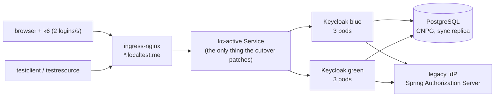

# Keycloak blue/green under load

A self-contained demo of zero-downtime Keycloak upgrades on Kubernetes (KinD): three Keycloak pods per color behind
ingress-nginx, Postgres via CloudNativePG, realm configuration through keycloak-config-cli, driven by Jenkins, measured
by k6 and two OIDC test apps while the cutover happens, and judged by a gate plus an HTML report.

Nothing is mocked on the path that matters: real brokered logins against a legacy Spring Authorization Server (users
live there; Keycloak holds no passwords), real token refreshes, logouts, back-/front-channel logout, introspection and
JWT validation at a resource server, with a custom provider JAR (mappers, authenticator, event listener) and theme.

## What it shows

| Case | From -> to | Mechanism | Downtime | What is lost |
|---|---|---|---|---|
| `patch` | 26.8.0 -> 26.8.1 | **shared DB**: green joins next to blue on the same Postgres, flip the `kc-active` Service | none | nothing |
| `minor` | 26.7.5 -> 26.8.1 | **lossy overlap**: green gets its own DB (CNPG replica of blue's, promoted at a copy point) and migrates it; blue keeps serving logins/tokens; logouts + new users from the window are replayed onto green; flip | none for login/token; admin + account console answer 503 for the window | sessions created in the window (`[copy_point, switch]`): users re-login silently through the legacy IdP's SSO |
| `major` | 25.0.6 -> 26.8.1 | lossy overlap | same | same |
| `patch-rollback`, `minor-rollback` | as above | switch, soak 90 s on the new version, roll back to the old color (lossy: to the old DB, after reverse-replaying the new color's logouts and new users) | none | rollback (lossy): sessions created on the new version |

Why lossy for minor/major: two Keycloak versions cannot share one database (the newer one migrates the schema), so a
strictly lossless cutover would need a write freeze. Because users authenticate at the legacy IdP, a lost Keycloak
session costs a redirect, not a password prompt; the demo makes that trade explicit and measures it.

## Topology



One Service selector routes the edge to exactly one color; the flip is a `kubectl patch` of that selector, so neither
the clients, the ingress nor the realm configuration change. Blue and green share a database in `patch` and have one
each in `minor`/`major` (green gets a replica of blue's, promoted at the copy point).

## Run it

Requirements: Docker with about 16 GB for the containers (measured peak 14.8 GiB, see Results; the laptop profile
below fits 10 GB), git,
bash with `curl`, `jq` and `openssl` on the host (Git Bash works on Windows). Everything else (kind, kubectl, helm,
Maven, GraalVM, k6) runs in containers. Hostnames are `*.localtest.me`, which resolve to 127.0.0.1 publicly.
`bash scripts/preflight.sh` (the launcher runs it first) checks exactly that: Docker daemon, Docker VM memory for the
profile, ports 443 and 8081, the host tools and the DNS record, and stops with one sentence instead of failing halfway
through a cluster build.

```bash
bash scripts/jenkins-secret.sh
```

```bash
docker compose run --rm launcher
```

```bash
docker compose up -d jenkins
```

1. `jenkins-secret.sh` generates the Jenkins admin password into `out/jenkins-admin-password` (gitignored).
2. The launcher runs `scripts/up.sh`: KinD cluster (1 control plane + 3 workers labelled zones a/b/c), ingress-nginx,
   CloudNativePG, certificates (demo CA in `out/certs/ca.crt`), the legacy IdP, the two native test apps, and a first
   blue Keycloak. Idempotent; the first run builds images and takes a while.
3. Jenkins: <http://localhost:8081>, user `admin`, password from step 1. Job **kc-bluegreen**, parameter `CASE`.
   Reset and Install run first; then two parallel branches — **Load** (k6 start, warm-up, cool-down) and **Cutover**
   (Switch, Soak + rollback) — joined by **Gate**. The load branch owns k6 for the whole run, so no pipeline step ever
   waits on the load; the one ordering point is the warm-up (the switch starts once sessions exist). Each phase logs a
   header saying what it does and why, and a result line with exit code and duration. The HTML report is built in
   every build's post step and archived with `out/**`.

Without Jenkins: `docker compose run --rm launcher bash scripts/demo.sh minor` (or `all`, or one phase:
`demo.sh minor switch`). Results land in `out/<case>/`: `k6.jsonl`, `apps.jsonl`, `events.jsonl`, `gate.txt`, the
Keycloak logs of each color, and `bash scripts/report.sh` writes `out/report.html`.

### Live demo, for an audience

One case, in a browser tab: a page that runs a real user journey every 2.5 s - brokered login through the legacy IdP
(authorization code + PKCE), a JWT-validated API call, a server-side introspection at the resource server, a refresh,
and a logout that must end the session - and reports every step as it happens.

```bash
bash scripts/live-demo.sh        # -> http://127.0.0.1:8098/
```

Flip the active color in another terminal while it runs (`docker compose run --rm launcher bash scripts/demo.sh patch
switch`, or a Jenkins build) and the page keeps counting through it: login, refresh and logout stay green,
introspection keeps answering `active: true`, and the latency bars show the cutover. The header links to the
pre-generated report (`out/report.html`, all five cases) so the detailed numbers are one click away. Needs Node >= 18
on the host; the client secret, the legacy user password and the CA come from the running cluster.

Admin console: <https://kc-net1.localtest.me/keycloak/admin> (trust `out/certs/ca.crt`; user `temp-admin`, password:
`kubectl -n keycloak get secret kc-bootstrap-admin -o jsonpath='{.data.password}' | base64 -d`).

Tear down: `bash scripts/down.sh`, then `docker compose down -v`.

### On a 16 GB laptop

```bash
PROFILE=laptop docker compose run --rm launcher
```

Then run cases with `PROFILE=laptop` (Jenkins build parameter, or
`PROFILE=laptop docker compose run --rm launcher bash scripts/demo.sh all`). The profile is recorded on the cluster;
a run with a different `PROFILE` stops before it changes anything.

Laptop = 2 KinD workers (zones a, b) instead of 3, 2 Keycloak pods per color instead of 3 (PDB 1 of 2, 1 GiB memory
limit), 2 Postgres instances per cluster instead of 3 (synchronous replication kept), the same load profile (2
logins/s, 3 app VUs), 2 ingress-nginx workers. Same images, config stages, switch scripts and gate rules.

Measured over all five cases (2.3 h of 15 s samples): **8.1 GiB** peak for the KinD nodes, **9.1 GiB** with Jenkins
(rollback phase of `minor-rollback`: both colors and both Postgres clusters up). The default profile peaks at
13.8 GiB / 14.8 GiB (Results). So give Docker Desktop / WSL2 about 10 GB (`.wslconfig`: `memory=10GB`), or skip Jenkins and use the
launcher. Not shown on the laptop profile: the 3-zone spread, a pod kill that leaves 2 serving pods per color (here 1),
the production PDB of 2 out of 3. Latency numbers are comparable within a run, not across profiles.

## How a run is judged

- **Gate** (`scripts/gate.sh`, rules explained in `scripts/gate/why.tsv`, printed under each row): no 5xx; issuer
  stable per network; same `sub` per user across versions; in-flight logins and refresh tokens survive (patch);
  pre-copy sessions survive and only window-born sessions are lost, each followed by a successful re-login (lossy);
  logged-out sessions never come back after the replay; the app rules (introspection, JWT, refresh, back-/front-channel
  logout delivered, logout effective); and that load really ran through the cutover (`load_through_cutover`) and the
  lossy window really was exercised (`window_exercised`), so no rule can pass on silence.
- **Report** (`out/report.html`, one tab per case): the data baseline (requests, users), error rates over time with
  the switch events marked, latency distributions before/during/after the cutover, and the failure-mode table with
  counts, rates and expected bounds. Every failure mode carries a one-line explainer of what it means to a user
  (`report/modes.tsv`). Definitions: [docs/failure-modes.md](docs/failure-modes.md).

## Results

Final run: Jenkins builds #44-#48 at commit `4743cf1`, default profile, one cluster, five cases back to back. Load
throughout: 2 brokered logins/s, refreshes every 5 s, logouts with probes, discovery/JWKS reads, 3 app VUs through the
two test apps - about 12 000-31 000 k6 requests per case. Every gate PASSes.

| | `patch` | `patch-rollback` | `minor` | `minor-rollback` | `major` |
|---|---|---|---|---|---|
| k6 requests | 12,639 | 15,012 | 23,451 | 30,730 | 21,231 |
| 5xx / network errors | 0 | 0 | 0 | 0 | 0 |
| error rate, whole run (cutover window) | 0 % (0 %) | 0 % (0 %) | 0.23 % (0.66 %) | 0.24 % (0.78 %) | 0.19 % (0.72 %) |
| users potentially impacted (of users seen) | 0 of 754 | 2 of 877 (0.2 %) | 26 of 1,252 (2.1 %) | 62 of 1,556 (4.0 %) | 31 of 1,155 (2.7 %) |
| lossy window (copy point -> switch) | - | - | 106.2 s | 105.3 s | 107.7 s |
| sessions lost = silent re-logins | 0 | 0 | 3 | 14 (+7 green-born, at the rollback) | 9 |
| logouts / new users replayed | - | - | 15 / 47 | 16 / 38 forward, 19 / 66 back | 15 / 47 |
| users repaired (post-flip race) | - | - | 0 | 0 | 3 |
| resurrection window (switch -> replay done) | - | - | 39.9 s | 37.0 s, rollback 43.8 s | 38.7 s |
| pod kill -> recovered (3 -> 2 -> 3 pods) | 43.3 s | 43.8 s | - | - | - |
| rollback (start -> traffic on the old color) | - | 0 s (Service flip) | - | 36.5 s (reverse replay) | - |
| p95 network latency pre / cutover / post | 161 / 170 / 142 ms | 174 / 164 / 146 ms | 159 / 162 / 143 ms | 164 / 155 / 143 ms | 160 / 158 / 144 ms |
| step classes with cutover p95 > 2x | introspection 3.05x | none | none | none | none |
| schema changesets | - | - | 211 -> 238 | 211 -> 238 | 134 -> 238 |

Reading it:

- **Users first**: 26 of 1,252 people in `minor`, 62 of 1,556 in `minor-rollback` and 31 of 1,155 in `major` were
  potentially impacted - they hit at least one error line (a lost session's `invalid_grant`, a straddling login, a
  channel logout for a session Keycloak no longer had) or a request over 1 s. The shared cases: nobody in `patch`,
  two in `patch-rollback` (slow only). The report counts each user once; the definition is in
  [docs/failure-modes.md](docs/failure-modes.md).
- The errors in the lossy cases are the trade the mechanism makes, all inside its bound: logins whose hops straddle
  the flip (started on blue, finished on green; the next attempt goes through legacy SSO), refreshes of sessions born
  in the lossy window (`invalid_grant`, then a silent re-login), and the apps' back-/front-channel logouts for those
  sessions (Keycloak on green never knew them). No session born before the copy point was lost, no logged-out session
  came back after the replay. In `major` three people were created twice in the post-flip race; the replay repaired
  them (first `sub` restored) and the gate excuses exactly those three.
- The shared cases (same DB) lose nothing. `patch` has one class over 2x, introspection 3.05x, inside a cutover
  window that also holds a pod kill (3 -> 2 pods for ~43 s); `patch-rollback`, same mechanism, has none. One run per
  case on one machine: expect run-to-run spread of that size.
- Admin and account console answer 503 for the whole cutover window in the lossy cases (copy point -> window end,
  ~150 s). Login, token, refresh, logout, discovery and JWKS never stop.
- Memory, default profile (`scripts/mem-sample.sh`, ~15 s apart, over all five cases): **13.8 GiB** peak for the four
  KinD nodes, **14.8 GiB** with Jenkins, during the `major` switch (both colors, both Postgres clusters, green
  migrating). Keycloak pod max 1.2 GiB, Postgres instance max 524 MiB.

The full numbers, per failure mode and per step class, are in the report (one tab per case).

## More

- [PLAN.md](PLAN.md): design, decisions and the **known limits** (what this demo deliberately does not solve).
- [docs/production-readiness.md](docs/production-readiness.md): what it would take to run this in an enterprise.
- [docs/test-apps.md](docs/test-apps.md): the OIDC test client and resource server (Spring Boot, GraalVM native).
- Security pipelines: Jenkins jobs **kc-kcwarden** (realm configuration audit) and **kc-security** (probes: TLS,
  tokens, redirect URIs, brute force, DCR, issuer, network policy, trivy, nuclei, ZAP, ...).
- Apache-2.0: [LICENSE](LICENSE). CI runs the offline checks (shellcheck, gate/report/lib tests) on every push
  (`.github/workflows/checks.yml`); the live cases need Docker and run through the local Jenkins.
