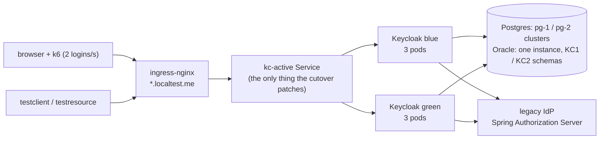

# Keycloak blue/green under load

A self-contained demo of zero-downtime Keycloak upgrades on Kubernetes (KinD): three Keycloak pods per color behind
ingress-nginx, Postgres (CloudNativePG) or Oracle Database, realm configuration through keycloak-config-cli, driven by Jenkins,
measured by k6 and two OIDC test apps while the cutover happens, and judged by a gate plus an HTML report.

Two database engines, one tree, one cluster at a time: **Postgres** (default, CloudNativePG) and **Oracle**
(`DB_ENGINE=oracle`, everything Oracle-specific in [oracle/](oracle/README.md)). The cases, load, gate and report are
the same; only the way green gets its copy of the database differs.

Nothing is mocked on the path that matters: real brokered logins against a legacy Spring Authorization Server (users
live there; Keycloak holds no passwords), real token refreshes, logouts, back-/front-channel logout, introspection and
JWT validation at a resource server, with a custom provider JAR (mappers, authenticator, event listener) and theme.

## What it shows

| Case | From -> to | Mechanism | Downtime | What is lost |
|---|---|---|---|---|
| `patch` | 26.8.0 -> 26.8.1 | **shared DB**: green joins next to blue on the same database, flip the `kc-active` Service | none | nothing |
| `minor` | 26.7.5 -> 26.8.1 | **lossy overlap**: green gets its own copy of blue's database at a copy point (Postgres: CNPG replica promoted at an LSN; Oracle: Data Pump copy of the schema at an SCN) and migrates it; blue keeps serving logins/tokens; logouts + new users from the window are replayed onto green; flip | none for login/token; admin + account console answer 503 for the window | sessions created in the window (`[copy_point, switch]`): users re-login silently through the legacy IdP's SSO |
| `major` | 25.0.6 -> 26.8.1 | lossy overlap | same | same |
| `patch-rollback`, `minor-rollback` | as above | switch, soak 90 s on the new version, roll back to the old color (lossy: to the old DB, after reverse-replaying the new color's logouts and new users) | none | rollback (lossy): sessions created on the new version |

Why lossy for minor/major: two Keycloak versions cannot share one database (the newer one migrates the schema), so a
strictly lossless cutover would need a write freeze. Because users authenticate at the legacy IdP, a lost Keycloak
session costs a redirect, not a password prompt; the demo makes that trade explicit and measures it.

## Topology



One Service selector routes the edge to exactly one color; the flip is a `kubectl patch` of that selector, so neither
the clients, the ingress nor the realm configuration change. Blue and green share a database in `patch` and have
one each in `minor`/`major` (green gets a copy of blue's at a copy point).

## Run it

Requirements: Docker with about 16 GB for the containers (measured peaks per engine: Results), git,
bash with `curl`, `jq` and `openssl` on the host (Git Bash works on Windows). Everything else (kind, kubectl, helm,
Maven, GraalVM, k6) runs in containers. Hostnames are `*.localtest.me`, which resolve to 127.0.0.1 publicly.
`bash scripts/preflight.sh` (the launcher runs it first) checks exactly that: Docker daemon, Docker VM memory for the
profile, ports 443 and 8081, the host tools and the DNS record, and stops with one sentence instead of failing halfway
through a cluster build.

```bash
bash scripts/jenkins-secret.sh
```

```bash
docker compose run --rm launcher
```

Oracle instead of Postgres: `DB_ENGINE=oracle docker compose run --rm launcher` (and `DB_ENGINE=oracle` on every later
launcher command, or the Jenkins build parameter `DB_ENGINE`). The engine is recorded on the cluster; a run with the
other engine stops before it changes anything. To change engines: `bash scripts/down.sh`, then bring up again.

```bash
docker compose up -d jenkins
```

1. `jenkins-secret.sh` generates the Jenkins admin password into `out/jenkins-admin-password` (gitignored).
2. The launcher runs `scripts/up.sh`: KinD cluster (1 control plane + 3 workers labelled zones a/b/c), ingress-nginx,
   the database platform (CNPG operator, or the 6 GiB Oracle 19.3 instance), certificates (demo CA in `out/certs/ca.crt`), the legacy IdP, the two native test apps,
   and a first blue Keycloak on the first database (`pg-1` / schema `kc1`). Idempotent; the first run builds images
   (a few minutes; Oracle 19.3 also creates its database, 15-20 minutes).
3. Jenkins: <http://localhost:8081>, user `admin`, password from step 1. Job **kc-bluegreen**, parameter `CASE`.
   Reset and Install run first; then two parallel branches — **Load** (k6 start, warm-up, cool-down) and **Cutover**
   (Switch, Soak + rollback) — joined by **Gate**. The load branch owns k6 for the whole run, so no pipeline step ever
   waits on the load; the one ordering point is the warm-up (the switch starts once sessions exist). Each phase logs a
   header saying what it does and why, and a result line with exit code and duration. The HTML report is built in
   every build's post step and archived with `out/**`.

Without Jenkins: `docker compose run --rm launcher bash scripts/demo.sh minor` (or `all`, or one phase:
`demo.sh minor switch`). Results land in `out/<case>/` (Oracle: `out/oracle/<case>/`): `k6.jsonl`, `apps.jsonl`, `events.jsonl`, `gate.txt`, the
Keycloak logs of each color, and `bash scripts/report.sh` writes `out/report.html` (`scripts/report.sh out/oracle` for the Oracle one).

### Live demo, for an audience

One case, in a browser tab: a page that runs a real user journey every 2.5 s - brokered login through the legacy IdP
(authorization code + PKCE), a JWT-validated API call, a server-side introspection at the resource server, a refresh,
and a logout that must end the session - and reports every step as it happens.

```bash
bash scripts/live-demo.sh        # -> http://127.0.0.1:8098/
```

Flip the active color in another terminal while it runs (`docker compose run --rm launcher bash scripts/demo.sh patch
switch`, or a Jenkins build) and the page keeps counting through it: login, refresh and logout stay green,
introspection keeps answering `active: true`, and the latency bars show the cutover. The header links to the
pre-generated report (`out/report.html`, all five cases) so the detailed numbers are one click away. Needs Node >= 18
on the host; the client secret, the legacy user password and the CA come from the running cluster.

Admin console: <https://kc-net1.localtest.me/keycloak/admin> (trust `out/certs/ca.crt`; user `temp-admin`, password:
`kubectl -n keycloak get secret kc-bootstrap-admin -o jsonpath='{.data.password}' | base64 -d`).

Tear down: `bash scripts/down.sh`, then `docker compose down -v`.

### On a 16 GB laptop

```bash
PROFILE=laptop docker compose run --rm launcher
```

Oracle: `PROFILE=laptop DB_ENGINE=oracle ORACLE_IMAGE=gvenzl/oracle-free:23.26.3-slim ORACLE_MEMORY=4Gi docker compose
run --rm launcher` (the 19.3 default needs the full profile; preflight refuses it here).

Then run cases with `PROFILE=laptop` (Jenkins build parameter, or
`PROFILE=laptop docker compose run --rm launcher bash scripts/demo.sh all`). The profile is recorded on the cluster;
a run with a different `PROFILE` stops before it changes anything.

Laptop = 2 KinD workers (zones a, b) instead of 3, 2 Keycloak pods per color instead of 3 (PDB 1 of 2, 1 GiB memory
limit), 2 Postgres instances per cluster instead of 3 or the 4 GiB gvenzl Free Oracle instance, the same load profile
(2 logins/s, 3 app VUs), 2 ingress-nginx workers. Same images, config stages, switch scripts and gate rules. Docker
Desktop / WSL2 memory (`.wslconfig`): 10 GB for Postgres (measured: 8.1 GiB peak for the KinD nodes, 9.1 GiB with
Jenkins, all five cases, 2026-11-03), about 13 GB for Oracle (an estimate, not measured). Not shown on the laptop
profile: the 3-zone spread, a pod kill that leaves 2 serving pods per color (here 1), the production PDB of 2 out of
3. Latency numbers are comparable within a run, not across profiles.

## How a run is judged

- **Gate** (`scripts/gate.sh`, rules explained in `scripts/gate/why.tsv`, printed under each row): no 5xx; issuer
  stable per network; same `sub` per user across versions; in-flight logins and refresh tokens survive (patch);
  pre-copy sessions survive and only window-born sessions are lost, each followed by a successful re-login (lossy);
  green's database copy is proven against the source (`db_copy_matches_source`: Postgres replica replayed past the
  copy LSN before the promote; Oracle copy holds exactly the users and sessions the source had at the copy SCN); logged-out sessions never come back
  after the replay; the app rules (introspection, JWT, refresh, back-/front-channel logout delivered, logout effective);
  and that load really ran through the cutover (`load_through_cutover`) and the lossy window really was exercised
  (`window_exercised`), so no rule can pass on silence.
- **Report** (`out/report.html`, one tab per case): the data baseline (requests, users), error rates over time with
  the switch events marked, latency distributions before/during/after the cutover, and the failure-mode table with
  counts, rates and expected bounds. Every failure mode carries a one-line explainer of what it means to a user
  (`report/modes.tsv`). Definitions: [docs/failure-modes.md](docs/failure-modes.md).

## Results

**Oracle 19.3 run, 2026-11-04:** Jenkins builds **#1** (`patch`), **#3** (`minor`), **#4** (`major`), **#5**
(`patch-rollback`), **#6** (`minor-rollback`) on the `oracle-19c` branch, default profile, one KinD cluster, five cases
back to back. Every gate PASSes. The database is Oracle 19.3 EE from the Docker Hub image
`mohammedesafi/oracle-database:19.3.0-ee` (a community build of Oracle's official 19.3 Dockerfiles, OTN Developer
License; not an Oracle-supported production image), with `ORACLE_SID=ORCLCDB`, `ORACLE_PDB=FREEPDB1`,
`ORACLE_MEMORY=6Gi`. The full report is `out/oracle19c-run/report.html` (gitignored; Jenkins archives the same file).
The gvenzl Oracle Free image is the fast alternative and also passed all five cases (report
`out/oracle-run/report.html`).

| | `patch` | `patch-rollback` | `minor` | `minor-rollback` | `major` |
|---|---|---|---|---|---|
| k6 requests | 14,744 | 15,902 | 14,552 | 21,156 | 14,761 |
| 5xx / network errors | 0 | 0 | 0 | 0 | 0 |
| error rate, whole run (cutover window) | 0 % (0 %) | 0 % (0 %) | 0.27 % (0.60 %) | 0.49 % (0.97 %) | 0.25 % (0.47 %) |
| users potentially impacted (of users seen) | 4 of 890 (slow only) | 2 of 945 (slow only) | 31 of 871 (3.6 %) | 63 of 1,185 (5.3 %) | 28 of 875 (3.2 %) |
| lossy window (copy point -> switch) | - | - | 147.5 s | 124.4 s | 153.4 s |
| sessions lost (born on the old color in the window, not in the copy) | 0 | 0 | 320 (313 users) | 291 (284 users), +377 green-born (364 users) at the rollback | 354 (345 users) |
| of those, seen lost by k6 = silent re-logins | 0 | 0 | 3 | 6 (+4 green-born, at the rollback) | 5 |
| logouts / new users replayed | - | - | 20 / 61 | 18 / 49 forward, 19 / 66 back | 22 / 74 |
| users repaired (post-flip race) | - | - | 0 | 0 | 0 |
| resurrection window (switch -> replay done) | - | - | 46.5 s | 40.9 s, rollback 42.4 s | 47.4 s |
| pod kill -> recovered (3 -> 2 -> 3 pods) | 43.1 s | 48.5 s | - | - | - |
| rollback (start -> traffic on the old color) | - | 0 s (Service flip) | - | 41.1 s (reverse replay + purge) | - |
| p95 network latency pre / cutover / post | 75 / 79 / 66 ms | 92 / 90 / 80 ms | 82 / 75 / 71 ms | 96 / 87 / 81 ms | 77 / 71 / 76 ms |
| step classes with cutover p95 > 2x | none | introspection 3.48x | none | none | none |
| schema changesets | - | - | 211 -> 238 | 211 -> 238 | 134 -> 238 |

Reading it:

- **Users first**: 31 of 871 people in `minor`, 63 of 1,185 in `minor-rollback` and 28 of 875 in `major` were
  potentially impacted - they hit at least one error line (a lost session's `invalid_grant`, a straddling login, a
  channel logout for a session Keycloak no longer had) or a request over 1 s. The shared cases: four slow-only users
  in `patch`, two in `patch-rollback`, no errors. The report counts each user once; the definition is in
  [docs/failure-modes.md](docs/failure-modes.md).
- **"Impacted" is what k6 saw, not the exposure.** k6 comes back to about ten sessions (its refresh VUs); the 2
  logins/s of the `login` scenario log in and never refresh. Every session created on blue between the copy point
  and the flip is missing on green: 320 sessions / 313 users in `minor`, 354 / 345 in `major`, 291 / 284 in
  `minor-rollback` plus 377 / 364 created on green and dropped by the rollback. That is roughly a third of the users
  seen in a run, and each of them re-logins (silently, through legacy SSO) the next time they return (k6 itself logged a few of
  them out again: 14 logout-scenario and 4 app sessions of the 320 in `minor`). The 3-6
  "seen lost" are the sample the gate judges, recomputed from the archived k6 lines with the current gate
  (`sessions_lost`, `sessions_lost_observed`, `green_sessions_born`).
- The errors in the lossy cases are the trade the mechanism makes, all inside its bound: logins whose hops straddle
  the flip (started on blue, finished on green; the next attempt goes through legacy SSO), refreshes of sessions born
  in the lossy window (`invalid_grant`, then a silent re-login), and the apps' back-/front-channel logouts for those
  sessions (Keycloak on green never knew them). No session born before the copy point was lost, no logged-out session
  came back after the replay, and no duplicate user needed repair in this run.
- The shared cases (same Oracle schema) lose nothing. `patch-rollback` has one class over 2x, introspection 3.48x,
  inside a cutover window that also holds a pod kill; `patch` has none. One run per case on one machine: expect
  run-to-run spread of that size.
- Admin and account console answer 503 for the whole cutover window in the lossy cases (copy point -> window end,
  ~125-155 s). Login, token, refresh, logout, discovery and JWKS never stop.
- The Data Pump copy: every green schema ends at the target Keycloak changeset count (238). These runs predate the
  row-count check (`db_copy_matches_source`: source AS OF the copy SCN vs the copy); their events only restate the
  SCN, so that rule has not passed on a live run yet. The Oracle instance is one 6 GiB pod; no Oracle memory sample was
  taken in this five-case run.

The full numbers, per failure mode and per step class, are in the report (one tab per case).

## More

- [oracle/README.md](oracle/README.md): the Oracle route, Data Pump cutover, 19.3/Free images, tools, limits.
- [PLAN.md](PLAN.md): design, decisions and the **known limits** (written for Postgres; oracle/README.md is
  the Oracle delta).
- [docs/production-readiness.md](docs/production-readiness.md): what it would take to run this in an enterprise.
- [docs/test-apps.md](docs/test-apps.md): the OIDC test client and resource server (Spring Boot, GraalVM native).
- Security pipelines: Jenkins jobs **kc-kcwarden** (realm configuration audit) and **kc-security** (probes: TLS,
  tokens, redirect URIs, brute force, DCR, issuer, network policy, trivy, nuclei, ZAP, ...).
- Apache-2.0: [LICENSE](LICENSE). CI runs the offline checks (shellcheck, gate/report/lib tests) on every push
  (`.github/workflows/checks.yml`); the live cases need Docker and run through the local Jenkins.
